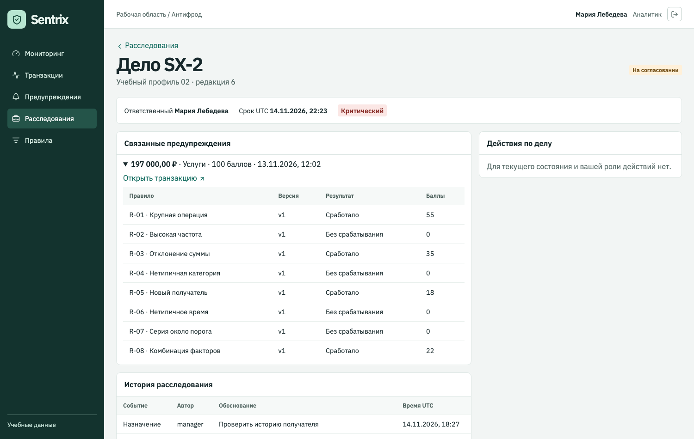

# Sentrix · Monitoring and investigations

[Русский](README.ru.md) · [English](README.en.md)

Fraud operations teams need to explain why an event was flagged, what the analyst reviewed and who made the final decision. Sentrix links normalized transaction events, versioned assessments, alerts and investigation evidence. A points score prioritizes review. A senior analyst makes the final decision. The data is synthetic and the application does not execute payments.

## Run locally

```sh
docker compose up --build --wait
```

Open [Sentrix](http://127.0.0.1:8130). Startup applies migrations and seeds synthetic records. Demo accounts use `Sentrix-local-demo`. See `.env.example` for the port and initial demo password.

| Login | Role |
| --- | --- |
| `analyst`, `analyst2` | Investigate assigned cases |
| `reviewer` | Review and close cases |
| `manager` | Assign cases, publish rules and check SLA |
| `rules` | Prepare draft versions and compare results |
| `admin` | Create users, read audit and run Lab |

## Detection and review

- REST and CSV accept events. Amounts are integer kopecks. Source and event ID identify exact replays and changed payload conflicts.
- Eight rule types evaluate amount, velocity, context and combined signals. A separate statistical method uses the median and median absolute deviation. The `sentrix-points/1` score ranges from 0 to 100.
- Reassessment reuses stored features and active rule versions. A manager publishes a version prepared by a rules administrator. Preview compares scores on a fixed synthetic sample.
- High-risk alerts group by customer and receipt day. An assigned analyst investigates and records evidence. A separate senior analyst closes the case and provides a rationale.
- The dashboard shows volumes, analyst workload, timing, outcomes and hits by rule version. Values come from PostgreSQL.

## Architecture and API

React, TypeScript, React Router, Vite and nginx deliver the workspace. FastAPI and Pydantic validate requests. SQLAlchemy runs PostgreSQL transactions, with Alembic managing schema changes. The database preserves immutable history. Row and advisory locks protect scoring and final decisions under concurrency.

[Requirements and decisions](docs/design.md) · [Data model](docs/diagrams/data.mmd) · [REST OpenAPI](docs/openapi.json) · [Swagger UI](http://127.0.0.1:8130/api/docs)

`backend/` holds server code and migrations, `frontend/` holds the client and browser tests, `tests/` and `scripts/` hold the verification suite, and `docs/` holds diagrams and documentation.

## Lab and verification

```sh
scripts/lab up
```

Open the [isolated lab](http://127.0.0.1:8131) as `admin`. Experiments show HTTP exchanges, stored state and the conditions they checked. `scripts/lab reset` recreates the lab database volume. [Test evidence and traceability](docs/verification.md) · [GitHub Actions](https://github.com/bivaettttt/sentrix/actions)

## Security and limits

The server checks roles and case assignment. Argon2 hashes passwords. Browser sessions hold tokens in page memory, and PostgreSQL stores token digests. Compose binds HTTP to loopback. Rules use typed parameters. Learning a model and reporting its accuracy would require independent labels. The current detector uses transparent statistical methods. [Status and future scope](docs/PROJECT_STATUS.md)

The project source has no separate license at this point. Third-party components retain their licenses.

## Demonstration



[Captures, video and walkthrough](docs/demo.md) · [Portfolio case study](docs/portfolio.md)
