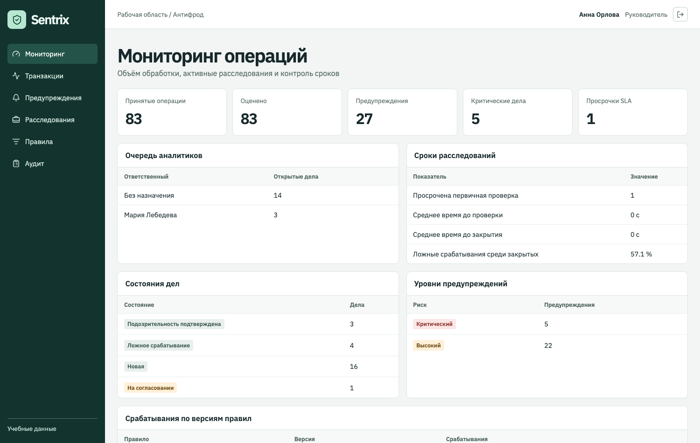

# Sentrix

Sentrix is an educational fraud monitoring workspace. It screens synthetic transactions, explains risk scores and routes alerts into investigations with independent human review.

Sentrix принимает синтетические операции, объясняет оценку риска и объединяет предупреждения в дела с независимым согласованием.

[Русский](README.ru.md) · [English](README.en.md) · [OpenAPI](docs/openapi.json) · [Проверки / Verification](docs/verification.md)

```sh
docker compose up --build
```

[Рабочая область / Workspace](http://127.0.0.1:8130)



[Скриншоты и сценарий / Captures and walkthrough](docs/demo.md)
