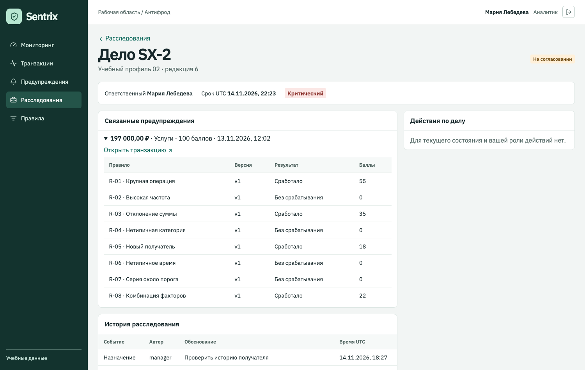

# Sentrix · Мониторинг и расследования

[Русский](README.ru.md) · [English](README.en.md)

Антифрод-команде нужно видеть, почему операция попала в проверку, что изучил аналитик и кто принял итоговое решение. Sentrix связывает нормализованное транзакционное событие, версионированные оценки, предупреждения и материалы расследования. Оценка помогает приоритизировать проверку. Итоговое решение принимает старший аналитик. Данные синтетические, денежные операции не исполняются.

## Запуск

```sh
docker compose up --build --wait
```

Откройте [Sentrix](http://127.0.0.1:8130). Миграции и данные создаются автоматически. Начальный пароль учебных пользователей — `Sentrix-local-demo`. `.env.example` описывает настройки порта и пароля при первом наполнении базы.

| Логин | Роль |
| --- | --- |
| `analyst`, `analyst2` | Ведут назначенные дела |
| `reviewer` | Согласовывает и закрывает дела |
| `manager` | Назначает дела, публикует версии, просматривает SLA |
| `rules` | Готовит черновики и сравнивает результаты |
| `admin` | Создаёт пользователей, просматривает аудит, запускает Lab |

## Как устроена проверка

- Событие принимается по REST или через CSV. Сумма хранится в целых копейках. Сочетание источника и идентификатора отличает точный повтор от конфликта.
- Восемь типов правил оценивают сумму, частоту, контекст и комбинации признаков. Отдельный статистический сигнал использует медиану и медианное абсолютное отклонение. Оценка версии `sentrix-points/1` лежит от 0 до 100.
- Повторная оценка использует сохранённые признаки и выбранные активные версии. Менеджер публикует версию, подготовленную администратором правил. Предпросмотр использует фиксированный синтетический набор.
- Предупреждения высокого риска группируются по клиенту и суткам приёма. Назначенный аналитик ведёт расследование и прикрепляет материалы. Старший аналитик закрывает дело с обоснованием.
- Сводка выводит объёмы, сроки, загрузку, результаты решений и срабатывания по версиям. Метрики рассчитываются из PostgreSQL.

## Архитектура и API

React, TypeScript, React Router, Vite и nginx обслуживают рабочую область. FastAPI и Pydantic принимают запросы. SQLAlchemy выполняет транзакции PostgreSQL. Alembic управляет схемой. PostgreSQL хранит неизменяемую историю, а блокировки защищают расчёт и итоговое решение при конкуренции.

[Требования и решения](docs/design.md) · [Модель данных](docs/diagrams/data.mmd) · [REST OpenAPI](docs/openapi.json) · [Swagger UI](http://127.0.0.1:8130/api/docs)

Исходники сервера и миграции находятся в `backend/`, интерфейс и Playwright в `frontend/`, проверки в `tests/` и `scripts/`, диаграммы и документация в `docs/`.

## Lab и проверка

```sh
scripts/lab up
```

Откройте [изолированную лабораторию](http://127.0.0.1:8131) под `admin`. Сценарии показывают запросы, ответы, состояние базы и проверенные условия. `scripts/lab reset` удаляет только том лаборатории. [Тесты и трассируемость](docs/verification.md) · [GitHub Actions](https://github.com/bivaettttt/sentrix/actions)

## Безопасность и границы

Доступ проверяется на сервере по роли и назначению дела. Пароли хешируются Argon2, токен сессии хранится в памяти страницы, а в базе сохраняется его хеш. Compose публикует HTTP только на loopback. Правила ограничены типизированными параметрами. Для моделей машинного обучения и оценок точности требуется независимая разметка, поэтому в этом проекте использован статистический модуль. [Статус и направления развития](docs/PROJECT_STATUS.md)

Отдельная лицензия на исходники проекта пока не назначена. Сторонние компоненты сохраняют свои лицензии.

## Демонстрация



[Скриншоты, видео и порядок показа](docs/demo.md) · [Материал для портфолио](docs/portfolio.md)
